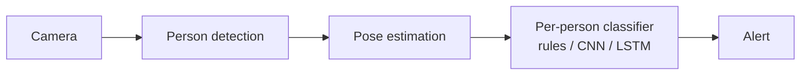
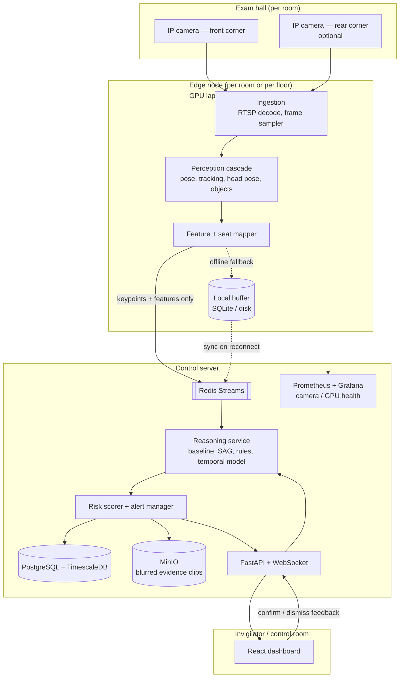
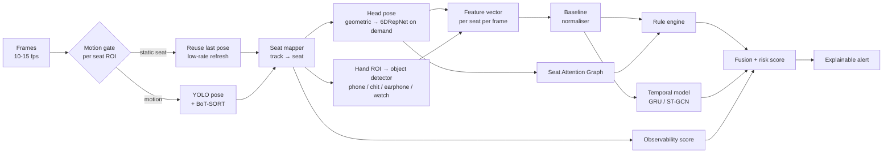
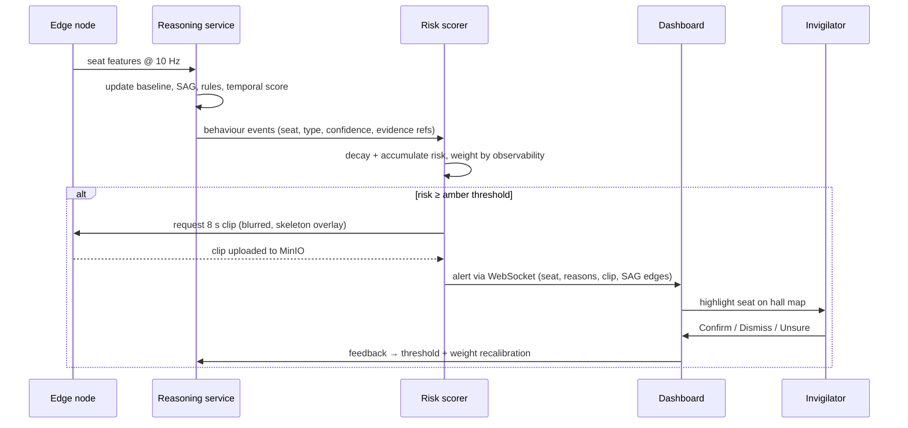
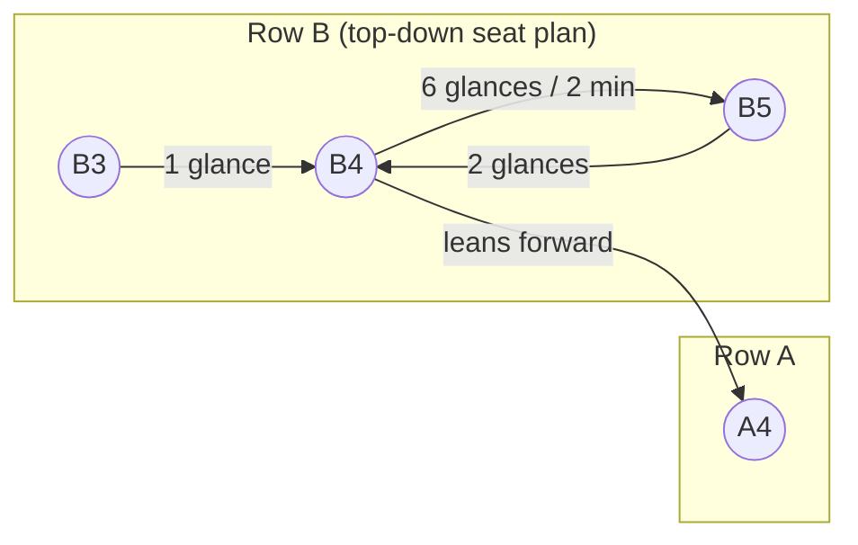
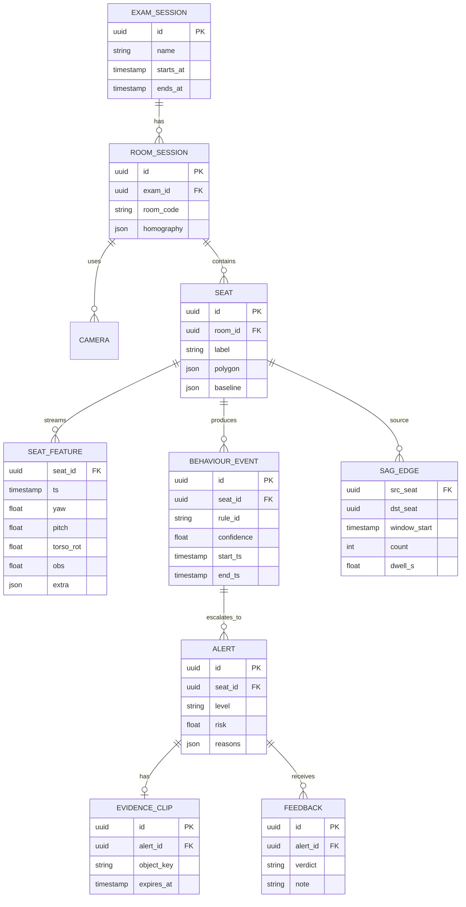

# SAGA — Seat Attention Graph Analysis

**Privacy-first, relation-aware AI invigilation using pose, gaze geometry and hand-object interaction**

> Problem Statement #1 — AI-Based Human Behaviour Monitoring Using Pose Estimation and Gesture Analysis (DJSCE)
> Version 1.1 · Project specification and build guide · v1.1: public-dataset-only data plan, semi-synthetic injection evaluation, corrected novelty claims

---

## Table of contents

1. [One-paragraph pitch](#1-one-paragraph-pitch)
2. [What already exists (landscape review)](#2-what-already-exists-landscape-review)
3. [Gaps we exploit](#3-gaps-we-exploit)
4. [What makes SAGA novel](#4-what-makes-saga-novel)
5. [System architecture](#5-system-architecture)
6. [The perception pipeline in detail](#6-the-perception-pipeline-in-detail)
7. [Feature engineering (per seat, per frame)](#7-feature-engineering-per-seat-per-frame)
8. [The Seat Attention Graph (core novelty)](#8-the-seat-attention-graph-core-novelty)
9. [Behaviour reasoning: rules + learned temporal model](#9-behaviour-reasoning-rules--learned-temporal-model)
10. [Risk scoring, observability and alerting](#10-risk-scoring-observability-and-alerting)
11. [Backend, data model and APIs](#11-backend-data-model-and-apis)
12. [Invigilator dashboard](#12-invigilator-dashboard)
13. [Privacy, ethics and compliance](#13-privacy-ethics-and-compliance)
14. [Risk register → mitigations](#14-risk-register--mitigations)
15. [Tech stack](#15-tech-stack)
16. [Data plan](#16-data-plan)
17. [Evaluation plan](#17-evaluation-plan)
18. [Repository structure](#18-repository-structure)
19. [Build roadmap](#19-build-roadmap)
20. [Demo script for judges](#20-demo-script-for-judges)
21. [References](#21-references)

---

## 1. One-paragraph pitch

Every existing exam-cheating system we reviewed treats each student as an isolated video clip: *is this person turning their head too much?* But offline exam misconduct is fundamentally **relational** — a student copies *from someone*, signals *to someone*, passes a chit *to someone*. **SAGA** models the exam hall as a **graph of seats**. It projects every student's head direction onto a calibrated floor/desk plan, builds a live **Seat Attention Graph** ("seat B4 has looked at seat B5's desk 6 times in 2 minutes; B5 has looked back twice"), and combines it with per-student self-calibrated baselines, hand-object interaction and a temporal model to produce **explainable, evidence-backed alerts** — without ever recognising a face. Identity is the seat number; the face is never stored.

---

## 2. What already exists (landscape review)

### 2.1 Academic systems (offline / classroom)

| System | Core technique | Strongest idea we reuse | Weakness we fix |
|---|---|---|---|
| **GPU-Free Pose Framework** (Haider et al., *Automation* 2025, MDPI) | YOLOv8-pose; head pose from two geometric triangles (nose–eyes, nose–ears); duration tracking; ~96% accuracy at ~6 FPS on CPU across six real exam days | Cheap geometric head-pose from keypoints; **dynamic per-student angle thresholds**; *duration* matters more than a single glance | Each student judged independently; head-only, no objects or hand interaction |
| **SE-YOLOv8 hierarchical system** (Information Retrieval Journal, 2025) | Frame differencing → improved YOLOv8 (MLP/attention) → pose + 3D-ResNet behaviour recognition | **Cascade / hierarchical gating**: cheap motion check before expensive models | Heavy 3D-CNN on raw video; privacy-unfriendly; no explanations |
| **Multiple-Human Pose Estimation** (MSA University) | Multi-person pose + tracking; head posture + hand movement rules; outputs "warning" not "cheating" | Non-accusatory language — warnings, not verdicts | Rule thresholds are fixed and global |
| **Skeleton + LSTM classroom cheating** (Tran et al., IJEECS) | YOLO-Pose keypoints → LSTM on skeleton sequences | Skeleton sequences as privacy-preserving input to a temporal model | Needs labelled sequences; no relational reasoning |
| **Malhotra & Chhabra — Automatic Invigilation** | Modified YOLOv3 + head/neck movement; ~88% | Early baseline | Frame-level only |
| **gembancud/Cheating-Detection** (thesis, GitHub) | OpenPose + XGBoost on Jetson Nano; proctor web app with evidence review | **Edge device per room + evidence storage UI** | Old pose model; single camera |
| **Skeleton anomaly detection** (Ding et al. 2022; ST-GCN patent CN110135319B) | ST-GCN on skeleton graphs for abnormal behaviour | Spatio-temporal graph conv over joints | Generic surveillance, not exam-specific |
| **Video-surveillance cheating detection** (i-JIM; "Anomalous Behavior in an Examination Hall") | Detects peeking at a neighbour's sheet, passing paper, signalling, turning around — single and multiple rows | Confirms neighbour-directed behaviours are detectable from CCTV | Interactions are **action labels on a clip/person**; no explicit who→whom relation over time |
| **Cheatomaly** (Alaoui Mrani et al., *Front. Big Data* 2026) | 94 real in-person exam videos; weakly supervised MIL anomaly ranking with ViT features | Explicitly separates *solo* vs *interaction-based* cheating and notes interaction cheating needs spatial-relationship modelling between students | Their model does not model inter-student relations — the exact gap SAGA targets |

### 2.2 Online-proctoring systems (ideas transfer well)

| System | Core technique | Idea we reuse |
|---|---|---|
| **AutoOEP** (NITK Surathkal, 2025) | Dual camera; YOLOv11n for phone/chit/headphone/watch; MediaPipe Hands; **hand-to-object distance**; LightGBM per-frame + **LSTM over 15-frame windows** | **Hand-object interaction** (presence ≠ use). Temporal model cut false positives from 58 → 9 vs. static model. Also a warning: chits and closed books were mostly confused with background (object detection alone is weak for paper) |
| **CHEESE** (Liu et al., IEEE TCDS 2024) | **Multiple Instance Learning**: whole video = bag, clips = instances; only video-level labels needed; spatio-temporal graph | Weak supervision — we only need to label *"this session contains cheating"*, not every frame |
| **Semi-supervised skeleton covert cheating** (Agh Atabay & Hassanpour) | Cheating as **time-series anomaly detection** on skeletons; per-individual training data helps; side-view camera effective | **Per-student "normal" model** + anomaly scoring |
| **Social gaze research** (LAEO / shared attention, Idiap 2024; CSGaze 2025) | Multi-person gaze-following; *Looking-At-Each-Other*, *Looking-At-Humans*, *Shared Attention* | **Relational gaze** between people — never applied to exam halls in the work we found |

### 2.3 Deployed industry systems (India)

- **TCS iON AI Command Centre** — live CCTV feeds; tracks candidate movement and devices; monitors 150+ parameters per exam to raise alerts.
- **UP Board 2026** — AI-enabled CCTV in exam centres and strongrooms; alerts reviewed at a central control room in Prayagraj.
- **UPPSC** — event records kept down to centre, room, **seat and roll number** (validates our seat-centric design).
- **NTA (NEET 2026 re-exam)** — ~1.38 lakh CCTV cameras across 95,000+ rooms, national control room + state units, "behavioural monitoring support".
- **Odisha BSE** — AI CCTV monitored centrally from Cuttack; flagged malpractice and also *invigilator* negligence.

**Takeaway:** governments are buying "AI CCTV + control room" at massive scale, but public descriptions focus on device detection, presence and movement. Fine-grained, explainable, privacy-preserving *behaviour* analysis at the seat level is the open space.

### 2.4 Typical architecture in prior work (what everyone draws)



Every prior system's diagram is a variant of this: a **single-person, single-path** pipeline. Our diagram (Section 5) adds a cascade, a seat graph, a baseline model, an observability model and a human feedback loop.

---

## 3. Gaps we exploit

| # | Gap in existing work | Evidence |
|---|---|---|
| G1 | **Relations are labels, not structure.** Prior work detects "peeking" or "passing paper" as per-student action classes, but does not model *directed, temporal relations between identified seats* (who looks at whom, how often, reciprocated or not). Cheatomaly names this gap explicitly. | 2.1 (i-JIM, Cheatomaly) |
| G2 | **Global thresholds** cause false positives for naturally fidgety students or students at odd camera angles. | MDPI paper needed dynamic thresholds; semi-supervised work found per-individual data helps |
| G3 | **Object presence ≠ cheating.** Phones/chits on a desk aren't proof; paper chits are hard to detect at all. | AutoOEP: chit/book recall poor, confused with background |
| G4 | **Frame-level decisions** → flicker and false alarms. | AutoOEP static vs LSTM (58 vs 9 FPs) |
| G5 | **Label scarcity.** Real cheating is rare and hard to annotate frame-by-frame. | CHEESE motivation |
| G6 | **No notion of "how well can I see this student?"** — occluded or far-away seats produce garbage poses that get misread as suspicious. | Risk table: occlusion, blind spots, head-pose errors |
| G7 | **No feedback loop.** Invigilator decisions are never used to improve the system. | None of the reviewed systems |
| G8 | **Privacy is an afterthought** (face recognition, raw video storage). | Several online systems use ArcFace/face-api |

---

## 4. What makes SAGA novel

Six contributions, each traceable to a gap:

1. **Seat Attention Graph (SAG)** — *G1.* Head direction rays are projected through a one-time **seat-map homography** onto the desk plane. Each frame produces directed edges `seat_i → seat_j` ("i is looking at j's desk"). Over time we detect **copying** (persistent one-way edges), **collusion** (reciprocal / alternating edges, synchronised turning), and **signalling** (mutual gaze + hand gesture). This turns social-gaze concepts (LAEO, shared attention) into an exam-hall primitive.
2. **Self-calibrating behavioural baseline** — *G2.* The first 3–5 minutes of every exam build a per-seat normal profile (yaw distribution, posture, hand activity). All later signals are **z-scores against that student's own baseline**, adjusted by camera geometry.
3. **Interaction-aware object reasoning** — *G3.* Objects only matter when **interacting** with a wrist keypoint, sitting **below the desk line**, or being **transferred across a seat boundary** (chit passing = object track crossing from seat A's zone into seat B's).
4. **Observability-weighted confidence** — *G6.* Every seat gets a live **observability score** (keypoint confidence, occlusion ratio, head size in pixels, angle to camera). Alerts are weighted by it, and seats with chronically low observability are flagged as **coverage gaps** to the invigilator instead of producing false alarms.
5. **Hybrid explainable reasoning with weak supervision** — *G4, G5.* An interpretable **rule engine** (always-on, explains itself) fused with a **temporal anomaly model** trained with **MIL on session-level labels** plus normal-only data.
6. **Invigilator-in-the-loop learning** — *G7.* Every *Confirm / Dismiss / Unsure* click is stored and used to recalibrate rule weights and thresholds per hall/camera (lightweight active learning).

Plus **privacy by design** (*G8*): no face recognition, keypoints-only storage, blurred evidence clips, auto-deletion.

---

## 5. System architecture

### 5.1 Deployment view



**Key design choice:** raw video never leaves the edge node. Only keypoints, features and short blurred evidence clips (on alert) go to the server.

### 5.2 Logical pipeline



### 5.3 Alert lifecycle



---

## 6. The perception pipeline in detail

### 6.1 Ingestion

- RTSP via OpenCV/GStreamer (or PyAV). For the demo, recorded MP4s replayed as RTSP with `mediamtx` so the pipeline is identical to live.
- Decode at native rate, **sample 10–15 fps** for pose, 3–5 fps for object detection.
- Pre-processing: CLAHE on the luminance channel for low light / glare; optional gamma correction.

### 6.2 One-time hall calibration (≈2 minutes per room)

Done in the dashboard before the exam:

1. Invigilator clicks the 4 corners of the desk area → **homography `H`** from image plane to a top-down seat plan.
2. Seat layout entered as rows × columns (or drawn); each seat gets an ID (`B4`) and an image-plane polygon (its desk + chair region).
3. A **desk line** per row is auto-derived (the y-level of the desk edge) — used for "hands below desk".
4. The seat plan defines **neighbour relations** (left, right, front, back, diagonal) for the SAG.

### 6.3 Detection, pose and tracking

- **Ultralytics YOLO pose** (YOLO26-pose or YOLO11-pose; both are recommended by Ultralytics for production). One forward pass → person boxes + 17 COCO keypoints.
- **Tracking:** BoT-SORT (built in) with re-ID off (no appearance features stored).
- **Seat locking:** each track is assigned to the seat polygon containing its hip/shoulder midpoint for ≥ N frames. If the tracker swaps IDs, the seat assignment wins. The *seat* is the identity; track IDs are internal only.

### 6.4 Motion-gated cascade (from SE-YOLOv8's hierarchical idea)

Per seat ROI, compute frame-difference energy. Seats with no motion reuse their last pose (refreshed every 1 s). This lets one GPU handle many more students, and the CPU fallback stays real-time.

### 6.5 Head pose — two tiers

| Tier | Method | When |
|---|---|---|
| T1 (always) | Geometric yaw/pitch from face keypoints: nose, eyes, ears (dual-triangle approach + ear-visibility asymmetry). Cost ≈ 0 | Every frame |
| T2 (on demand) | **6DRepNet** (or similar) on an upscaled head crop → yaw/pitch/roll | When T1 is near a threshold, or when the seat is far from camera |

Camera-angle correction: a student seated far left of the camera has a non-zero "neutral" yaw. The baseline (Section 9.1) absorbs this automatically.

### 6.6 Hands and objects (interaction-aware)

- Wrist keypoints from pose; optional **MediaPipe Hands** on wrist crops for finger detail (signalling gestures).
- Object detector (YOLO nano, fine-tuned) runs on **hand/desk ROIs**, not the full frame → small objects become larger in pixels. Classes: `phone`, `chit`, `earphone`, `smartwatch`, `calculator` (if prohibited), `book`.
- Interaction features: wrist-to-object distance (normalised by shoulder width), object-below-desk-line, object track crossing a seat boundary.

### 6.7 Observability score (per seat, per frame)

```
obs = mean_conf(face + upper-body keypoints)
      × (1 − occlusion_ratio)              # overlap of this seat's box by others
      × clamp(head_height_px / 40, 0, 1)   # tiny heads → unreliable pose
      × angle_factor                       # seats near 90° to camera axis penalised
```

---

## 7. Feature engineering (per seat, per frame)

| Feature | Definition | Detects |
|---|---|---|
| `yaw`, `pitch` | Head angles (T1/T2) | Sideward glances, looking down at lap |
| `yaw_z` | (yaw − μ_baseline) / σ_baseline | Deviation from *this* student's normal |
| `yaw_vel` | Δyaw / Δt | Quick "peek" glances |
| `torso_rot` | Angle of shoulder line vs baseline | Body rotation toward neighbour |
| `lean_x` | Lateral shift of neck vs hip midpoint | Leaning toward neighbour's desk |
| `wrist_below_desk` | Either wrist y > desk line for this row | Hidden material / phone in lap |
| `wrist_speed` | Normalised wrist velocity | Unusual hand movement, signalling |
| `hand_near_face` | Wrist-to-nose distance / shoulder width | Earpiece adjustment, covering mouth |
| `obj_interact` | Prohibited object within k·shoulder-width of a wrist | Active phone/chit use |
| `obj_transfer` | Object track moves from seat A zone into seat B zone | Chit passing |
| `gaze_target` | Seat whose desk the head ray hits on the seat plan (or `own`, `front`, `none`) | Input to Seat Attention Graph |
| `obs` | Observability score | Confidence weighting |

---

## 8. The Seat Attention Graph (core novelty)

### 8.1 Construction

For seat *i* at time *t*:

1. Head centre `h_i` and direction from (yaw, pitch) give a ray in image space.
2. Project the ray onto the desk plane with homography `H`.
3. The first neighbour desk polygon intersected (within a max distance of ~1.5 seats) becomes the **gaze target** `g_i(t)`.
4. Add directed edge `i → g_i(t)` with weight = `obs_i · dwell_time`.

The graph is maintained over sliding windows (30 s, 2 min, 10 min).



### 8.2 Relational patterns detected

| Pattern | Graph signature | Example explanation |
|---|---|---|
| **One-way copying** | Persistent `i → j` edges with high dwell, `j` mostly looking at own desk | "B4 looked at B5's desk 6 times (avg 2.1 s) in 2 min; B5 not reciprocating" |
| **Mutual collusion** | Reciprocal edges `i ⇄ j` within short lag, or alternating turns | "B4 and B5 turned toward each other 3 times within 5 s windows" |
| **Signalling** | Mutual gaze + `wrist_speed` spike or hand gesture on either side | "A2 faced A3 while making repeated hand gestures" |
| **Chit passing** | `obj_transfer` from *i* to *j* + edges between them | "Paper object moved from B4's zone into B5's zone" |
| **Cluster** | Strongly connected component of ≥ 3 seats | "Seats C2–C3–D3 show repeated mutual orientation" |
| **Hub** | Seat with high in-degree (many look *at* it) | "Multiple students repeatedly oriented toward seat D4" — flags potential *source* of copying |

Graph metrics: in/out degree, reciprocity, temporal cross-correlation of yaw signals between neighbours, strongly connected components. NetworkX is enough at hall scale (≤ 60 seats).

### 8.3 How novel is this — honest positioning

**Not novel (do not claim):** detecting neighbour-directed actions (peeking, passing paper) from video; using seat adjacency to find copiers (psychometrics has done this from answer sheets for decades); projecting gaze rays onto a room layout (used in classroom gaze research); students-as-graph (proposed for online exams).

**Novel combination (claim this):** a *directed, temporal seat-to-seat attention graph* built from homography-projected head orientation in offline exam halls, used to attribute **who copies from whom** (copier vs. source) and detect reciprocity (collusion). Prior systems output "student X peeked"; SAGA outputs "B4 → B5, 6×, one-way".

**Pitch wording:** *"Unlike prior systems that classify peeking per student, SAGA models directed attention between seats over time, identifying the pair and the direction of copying."*

**Before writing "first" anywhere:** do a proper literature search on Google Scholar / IEEE Xplore (terms: "examinee interaction", "copying direction", "peeping neighbour", "exam room relation"). Much exam-room work is in Chinese venues (CNKI) that web search covers poorly.

### 8.4 Optional extension — video + answer-sheet forensics

After the exam, SAG edges can serve as priors for psychometric collusion indices (identical-wrong-answer statistics between seat neighbours). "B4 glanced at B5 nine times **and** they share 7 identical wrong answers" is far stronger evidence than either alone. This fusion appears unexplored and is a strong research angle.

---

## 9. Behaviour reasoning: rules + learned temporal model

### 9.1 Calibration phase (first 3–5 minutes)

For each seat, estimate robust statistics (median, MAD) for yaw, pitch, torso rotation, wrist activity. Students are reading the paper, so this approximates "normal". Students who join late get a rolling baseline. Baselines are **clipped** so a cheater can't inflate their own baseline (cap σ at hall-level 75th percentile).

### 9.2 Rule engine (explainable layer)

Rules are YAML so non-programmers can tune them:

```yaml
- id: SIDE_GLANCE_REPEAT
  when: abs(yaw_z) > 2.5 and gaze_target in neighbours
  min_duration_s: 1.2
  count: ">= 3"
  window_s: 60
  weight: 0.35
  message: "Repeated sideward glances toward {gaze_target} ({count}× in {window_s}s)"

- id: HANDS_BELOW_DESK
  when: wrist_below_desk and pitch_z < -2
  min_duration_s: 6
  weight: 0.30
  message: "Looking down with hands below desk for {duration}s"

- id: OBJECT_IN_USE
  when: obj_interact.class in [phone, earphone, smartwatch]
  min_frames: 8
  weight: 0.60
  message: "{obj_class} held near hand for {duration}s"

- id: MUTUAL_ORIENTATION
  when: sag.reciprocal(seat, neighbour, lag_s=5)
  count: ">= 2"
  window_s: 120
  weight: 0.45
  message: "Mutual orientation with {neighbour} ({count}× in 2 min)"

- id: CHIT_TRANSFER
  when: obj_transfer
  weight: 0.70
  message: "Paper-like object moved from {src} to {dst}"
```

### 9.3 Temporal model (learned layer)

- **Input:** sequences of the Section 7 feature vectors (baseline-normalised), 2 s windows at 10 Hz → 20 × ~15 features; optionally raw keypoint sequences for an ST-GCN branch.
- **Model A (MVP):** 2-layer GRU (hidden 64) → anomaly probability. Mirrors AutoOEP's finding that temporal models sharply reduce false positives vs. per-frame classifiers.
- **Model B (stretch):** lightweight **ST-GCN** on 17-joint skeletons (via PYSKL / MMAction2).
- **Training strategy (weak supervision):**
  - *Normal-only pretraining:* autoencoder / forecasting model on normal sessions → reconstruction error as anomaly score (semi-supervised approach).
  - *MIL fine-tuning (CHEESE-style):* each recorded session per seat = bag; 2 s clips = instances; label only "this seat's session contained misconduct" → ranking loss pushes the top-k clips in positive bags above all clips in negative bags.
- The temporal model **never alerts alone**; it contributes to the risk score and can only escalate an alert that has at least one rule-level explanation, or produce a low-priority "unusual pattern, review" note.

---

## 10. Risk scoring, observability and alerting

Per seat *s*:

```
R_s(t) = R_s(t−Δt) · e^(−λΔt)
         + Σ_k  w_k · c_k · obs_s          # rule events k with confidence c_k
         + β · max(0, A_s(t) − τ_A)        # temporal anomaly score above threshold
```

- `λ` → half-life ≈ 3 minutes (old behaviour fades).
- `w_k` → per-rule weights, recalibrated from invigilator feedback.
- `obs_s` → observability; low-visibility seats can't accumulate high risk from noisy signals.

| Level | Condition | Action |
|---|---|---|
| Green | R < 0.4 | Nothing |
| Amber | 0.4 ≤ R < 0.75 | Seat glows on map, "watch" note, clip captured |
| Red | R ≥ 0.75 or any `OBJECT_IN_USE` / `CHIT_TRANSFER` with c > 0.8 | Push alert with reasons + clip |
| Grey | `obs` < 0.3 for > 60 s | "Coverage gap" — suggests invigilator walk-by |

**Alert payload (always factual, never accusatory):**

```json
{
  "seat": "B4",
  "level": "red",
  "risk": 0.82,
  "observability": 0.91,
  "reasons": [
    "Looked toward B5's desk 6× (avg 2.1 s) in the last 2 min",
    "Torso rotated 31° toward B5 (baseline 4°)",
    "Mutual orientation with B5 twice"
  ],
  "related_seats": ["B5"],
  "clip_url": "/evidence/clip_8f2a.mp4",
  "started_at": "2026-11-12T10:14:03+05:30"
}
```

---

## 11. Backend, data model and APIs

### 11.1 Services

| Service | Responsibility | Tech |
|---|---|---|
| `edge-agent` | Ingest, perception, features, seat mapping, clip cutter | Python, Ultralytics, OpenCV, ONNX Runtime / TensorRT |
| `reasoner` | Baselines, SAG, rules, temporal model, risk | Python, NumPy, NetworkX, PyTorch |
| `api` | REST + WebSocket, auth, feedback ingestion | FastAPI, Pydantic, SQLAlchemy |
| `bus` | Feature and event streams | Redis Streams (Kafka at multi-centre scale) |
| `storage` | Events, time-series features, feedback | PostgreSQL + TimescaleDB |
| `evidence` | Short blurred clips | MinIO (S3-compatible) |
| `monitor` | Camera FPS, GPU temp, stream health | Prometheus + Grafana |

### 11.2 Data model



Seat ↔ roll-number mapping is **not** stored in SAGA; the invigilator's existing seating chart does that offline.

### 11.3 API surface

| Method | Path | Purpose |
|---|---|---|
| POST | `/rooms/{id}/calibration` | Save homography + seat polygons |
| POST | `/sessions/{id}/start` · `/stop` | Begin/end monitoring (starts baseline phase) |
| GET | `/sessions/{id}/seats` | Current seat states (risk, obs, level) |
| WS | `/ws/sessions/{id}` | Live seat states, alerts, SAG edges |
| GET | `/alerts?session=…&level=…` | Alert history |
| POST | `/alerts/{id}/feedback` | Confirm / Dismiss / Unsure + note |
| GET | `/sessions/{id}/report` | Post-exam PDF/JSON report |
| GET | `/health/cameras` | Stream FPS, last frame time, obs coverage |

---

## 12. Invigilator dashboard

React + Vite + Tailwind; seat map drawn with SVG/Konva; charts with Recharts.

Views:

1. **Live hall map** — top-down seat grid, each seat coloured by risk level; SAG edges drawn as arrows between seats (thickness = frequency); grey seats = coverage gaps.
2. **Alert feed** — newest first; each card shows seat, reasons, related seats, 8 s blurred clip with skeleton overlay, and Confirm / Dismiss / Unsure buttons.
3. **Seat timeline** — click a seat → yaw/posture sparkline vs. its baseline band, events on a timeline.
4. **Camera health** — FPS, dropped frames, observability heatmap ("seats D5–D7 poorly visible from Cam 1").
5. **Post-exam report** — per-session summary, all alerts with outcomes, false-alarm rate, coverage stats.

---

## 13. Privacy, ethics and compliance

**Principles built into the architecture**

- **No face recognition, no biometric templates.** Identity = seat label.
- **Data minimisation:** edge sends keypoints + features, not frames. Raw video is held in a rolling RAM buffer (~30 s) only to cut evidence clips.
- **Evidence clips:** faces blurred (face region derived from keypoints), skeleton overlaid, auto-deleted after a configurable retention window (e.g. 30 days or after result declaration).
- **Human decides.** System language is "observed behaviour", never "cheating". No automated penalties.
- **Transparency:** students are informed (notice on admit card / hall entry) that AI-assisted monitoring is active and what it does *not* do.
- **Fairness checks:** compare alert rates across seat positions, lighting zones and camera distance; a seat position that alerts far more often indicates a calibration bias, not a behaviour difference.
- **Access control:** role-based (invigilator sees own room; exam controller sees all); audit log on every clip view.

**Indian regulatory context (research summary, not legal advice).** The DPDP Rules, 2025 were notified in November 2025 with obligations phasing in over ~18 months. They generally require verifiable parental consent for children's data and restrict behavioural monitoring of children, but carve out educational institutions processing data for academic activities, behavioural monitoring and student safety. For college exams most candidates are adults, so standard notice-and-purpose-limitation obligations apply. Our minimisation-first design (no biometrics, keypoint-only storage, short retention) is chosen to sit comfortably within this framework.

---

## 14. Risk register → mitigations

| Risk (from PS) | Mitigation in SAGA |
|---|---|
| False positives | Per-seat baseline z-scores; duration + repetition rules; temporal model; observability weighting; invigilator feedback recalibrates weights |
| False negatives | Relational SAG catches copying that individual thresholds miss; hand-ROI object detection improves small-object recall; two-camera option |
| Occlusion | Occlusion ratio lowers obs; low-confidence keypoints are excluded rather than guessed; rear camera fills gaps |
| Poor lighting | CLAHE / gamma; training augmentation for low light & glare; obs drops when keypoint confidence drops |
| Camera blind spots | Calibration shows per-seat coverage before the exam starts; grey "coverage gap" state during exam |
| Head pose errors at distance | Two-tier head pose (geometric → 6DRepNet on upscaled crop); camera-angle neutral absorbed by baseline |
| Multi-person tracking failure | Seat-locked identity overrides tracker ID swaps |
| Network failure | Edge buffers events locally and syncs on reconnect; dashboard shows "edge offline" |
| Hardware failure | Heartbeats; Grafana alerts on FPS drop / GPU temperature; graceful degradation to CPU mode at lower fps |
| Privacy concerns | No face recognition; keypoints-only; blurred clips; retention limits; audit log; student notice |

---

## 15. Tech stack

| Layer | Choice | Notes |
|---|---|---|
| Language | Python 3.11 (ML/backend), TypeScript (frontend) | |
| Pose + detection | Ultralytics **YOLO26-pose / YOLO11-pose** (n/s variants) | Single model for box + keypoints |
| Tracking | BoT-SORT / ByteTrack (Ultralytics built-in) | Re-ID disabled |
| Head pose | Geometric (keypoints) + **6DRepNet** | |
| Hands | MediaPipe Hands (optional) | Signalling gestures |
| Object detection | YOLO nano fine-tuned on hand/desk ROIs | |
| Temporal model | PyTorch GRU; ST-GCN via PYSKL/MMAction2 (stretch) | |
| Graph | NetworkX | |
| Inference optimisation | ONNX Runtime; TensorRT FP16 on NVIDIA | |
| Video I/O | OpenCV / PyAV; **mediamtx** to replay MP4 as RTSP | |
| Streaming | Redis Streams | Kafka for multi-centre |
| API | FastAPI + WebSockets | |
| DB | PostgreSQL + TimescaleDB | |
| Object storage | MinIO | |
| Frontend | React, Vite, Tailwind, Konva/SVG, Recharts | |
| Annotation | CVAT or Label Studio | |
| Experiment tracking | Weights & Biases or MLflow | |
| Monitoring | Prometheus + Grafana | |
| Packaging | Docker Compose (edge + core) | |
| Hardware (demo) | Laptop with RTX 3050/3060 or better; 1–2 IP cams or phones as RTSP cameras | |
| Hardware (pitch) | Jetson Orin Nano per room | |

**Throughput target:** ≥ 10 fps per stream for 30 students on one mid-range GPU; ≥ 5 fps CPU-only fallback.

---

## 16. Data plan

**Constraint:** no self-recorded dataset and no author-request datasets. Everything below is **publicly downloadable**. The strategy splits evaluation into two layers:

- **Perception layer** (pose, head angle, posture, objects) → evaluated on **real public data** with existing labels.
- **Reasoning layer** (baseline, rules, Seat Attention Graph) → evaluated by **semi-synthetic behaviour injection** into real classroom skeleton tracks (16.3). This works because the reasoning layer consumes keypoints/angles, not pixels.

### 16.1 Public datasets — what to download and why

| # | Dataset | What it is | Role in SAGA |
|---|---|---|---|
| D1 | **CCTV Exam Monitor Dataset** (Kaggle: `cctvdataset/cctv-exam-monitor-dataset`) | Real CCTV images from exam rooms and computer labs, anonymised; varied lighting/angles. Classes: CorrectPosture, LeftSideMove, RightSideMove, ForwardMove, BackwardMove, Stand | ⭐ Primary **perception benchmark** in the exact setting: evaluate head-yaw / torso-rotation features against LeftSide/RightSide/Forward labels |
| D2 | **SAV — Student Action Video** (GitHub: `Ritatanz/SAV`) | 4,324 clips from 758 real classrooms, 15 multi-label student actions, AVA-style; 4–68 students per room | ⭐ Primary **real multi-person video**: tracking, seat locking, head-turn timing, and the *normal* skeleton tracks used for injection (16.3). Read the README — users must accept a no-redistribution agreement |
| D3 | **SCB-Dataset** (Hugging Face: `wintonYF/SCB-Dataset`; also GitHub `Whiffe/SCB-dataset`) | Large classroom behaviour image sets (incl. turn head, bow head, using phone; up to 20 classes) + spatio-temporal version | Crowded-classroom detector pretraining; phone / head-turn sanity checks |
| D4 | **ExamCheating_Dataset** (Kaggle: `ardutraagiginting/exam-cheating-dataset`) | Images: looking_friend, cheating, normal_act, giving_code, giving_object | Quick prototyping of neighbour-directed cues. Scraped from YouTube/TikTok/films → **prototype only, do not publish results on it** |
| D5 | **Roboflow Universe** exam/cheating + phone/paper sets | Thousands of YOLO-format boxes (some keypoint sets) | Train the hand-ROI object detector (phone, chit, earphone, watch) |
| D6 | **Student Classroom Behavior Dataset** (Figshare, DOI 10.6084/m9.figshare.29979148) | 1,829 images: hand-raising, reading, writing, using phone, bowing head, leaning | Phone-use and posture detection |
| D7 | **Free stock footage** (Mixkit, Coverr) | Licensed classroom/exam clips, mostly normal behaviour | False-alarm checks + **public demo/PPT footage** (licence permits display) |

**Excluded on purpose:** BNU Student Class Behavior Dataset (listed by the SCB maintainers as not open source); author-request datasets (Cheatomaly, CAN, Hussein et al.) — can be added later if access is obtained.

### 16.2 Download instructions

```bash
# --- Kaggle (D1, D4) ---
pip install kaggle
# kaggle.com → Settings → API → "Create New Token" → save kaggle.json to:
#   Linux/Mac: ~/.kaggle/kaggle.json   Windows: C:\Users\<you>\.kaggle\kaggle.json
kaggle datasets download -d cctvdataset/cctv-exam-monitor-dataset -p data/cctv_exam --unzip
kaggle datasets download -d ardutraagiginting/exam-cheating-dataset -p data/exam_cheating --unzip

# --- Hugging Face (D3) ---
pip install -U "huggingface_hub[cli]"
huggingface-cli download wintonYF/SCB-Dataset --repo-type dataset --local-dir data/scb

# --- SAV (D2) ---
git clone https://github.com/Ritatanz/SAV
# Follow the README for the video download link / agreement.

# --- Roboflow (D5) ---
# On universe.roboflow.com → open dataset → "Download Dataset" → format "YOLOv8/YOLO11" → zip
# (or pip install roboflow and use the snippet Roboflow shows you, with your free API key)

# --- Figshare (D6) ---
# Open the DOI page in a browser → Download (≈504 MB)
```

Keep all data in `data/` and add `data/` to `.gitignore` — never commit datasets to the repo.

### 16.3 Semi-synthetic behaviour injection (reasoning-layer evaluation)

A standard anomaly-detection technique: real normal data + controlled, labelled anomalies.

1. **Extract normal tracks.** Run the perception pipeline on D2 classroom clips (and D1 sequences where available). Store per-seat time series: yaw, pitch, torso rotation, wrist positions, observability. Assume these are normal (real classroom, no exam cheating).
2. **Calibrate a pseudo seat map** per clip: fit a row/column grid to detected student positions (no physical calibration needed).
3. **Inject behaviours** into selected seats with known ground truth:

   | Injected pattern | How it is synthesised |
   |---|---|
   | One-way copying (i → j) | Add k glance events to seat i's yaw toward j's bearing: smooth ramp (0.3 s) → hold (1–3 s) → return; optional small torso rotation |
   | Mutual collusion (i ⇄ j) | Glances on both seats toward each other within a 0–5 s lag |
   | Signalling | Mutual orientation + wrist-speed bursts on either seat |
   | Hands under desk | Wrist y pushed below desk line + pitch drop for 5–15 s |
   | Chit transfer | Synthetic object track moving from seat i's zone to j's zone |

4. **Difficulty sweep:** vary glance amplitude (15°–60°), duration (0.5–3 s), frequency (1–8 per 2 min) and keypoint noise. Plot detection rate vs. subtlety — this curve is a headline result.
5. **Metrics:** event recall/precision, *correct-neighbour attribution rate* (did SAG name the right j?), direction accuracy (copier vs. source), false alarms per student-hour on untouched real seats.

**Honest framing (use this sentence in the pitch/paper):** *"Perception was evaluated on real exam-room CCTV (Kaggle) and real classroom video (SAV); relational reasoning was evaluated by controlled behaviour injection into real classroom skeleton tracks."* Do not claim evaluation on real cheating footage.

### 16.4 Qualitative sanity checks (private only)

Short public news clips of exam-hall CCTV (e.g. the 2023 Walter Sisulu University clip showing two students exchanging a paper) may be used **locally** to check that SAG links the right seat pair.
Rules: keep files private, never redistribute or commit them, never show identifiable frames publicly (use skeleton overlays), and do not use clips involving minors or tied to tragedies/ongoing investigations. Prefer screen recording (OBS) over third-party downloader sites.

### 16.5 Live demo footage

- **Teammates as actors at the venue:** 3–4 people seated in a row in front of the laptop/phone camera — two minutes, no dataset needed.
- **Stock footage (D7)** for anything shown in slides or recorded videos.
- Optional: Blender + free Mixamo characters for a rendered exam hall with perfect ground truth.

### 16.6 Augmentation

Brightness/contrast/gamma shifts, motion blur, synthetic occlusion (random boxes over upper body), horizontal flip **with seat-relation relabelling** (left/right neighbours swap).

---

## 17. Evaluation plan

### 17.1 Metrics

| Level | Data | Metric |
|---|---|---|
| Perception — posture/head | D1 CCTV Exam Monitor | Accuracy / F1 of yaw + torso features vs. LeftSide / RightSide / Forward / Backward labels; confusion matrix |
| Perception — tracking | D2 SAV | ID switches per minute with vs. without seat locking; head-pose MAE on a few hand-checked frames |
| Perception — objects | D5 Roboflow, D3/D6 phone classes | mAP@0.5 on hand-ROI crops vs. full frame |
| Event detection | Injected D2 tracks (16.3) | Per-behaviour precision / recall / F1, temporal IoU ≥ 0.3 |
| Relational | Injected D2 tracks | Correct-neighbour attribution rate; copier-vs-source direction accuracy; collusion pair recall |
| False alarms | Untouched real D2 tracks + D7 stock footage | **False alarms per student-hour** |
| Operational | Any video | Glass-to-alert latency (target < 3 s); fps per stream; streams per GPU |

### 17.2 Ablations (this is what makes it paper-worthy)

1. Global thresholds vs. per-seat baseline
2. Individual-only vs. + Seat Attention Graph
3. Object presence vs. interaction-aware objects
4. Rules only vs. temporal model only vs. fusion
5. With vs. without observability weighting
6. Full frame vs. hand-ROI object detection
7. Motion-gated cascade vs. full processing (fps and accuracy)

8. Detection rate vs. injected-behaviour subtlety (amplitude / duration / frequency sweep)

### 17.3 Fairness

Alert rate by seat row/column, distance from camera and lighting zone on *normal-only* sessions (untouched D2 tracks) — should be flat.

---

## 18. Repository structure

```
saga/
├── edge/
│   ├── ingest/            # rtsp reader, frame sampler, clip buffer
│   ├── perception/        # pose, tracker, head_pose, objects, hands
│   ├── calibration/       # homography, seat polygons, desk lines
│   ├── features/          # feature extractor, observability
│   └── main.py
├── reasoner/
│   ├── baseline.py
│   ├── sag.py             # Seat Attention Graph
│   ├── rules/             # engine.py + rules.yaml
│   ├── temporal/          # gru.py, stgcn/, mil_train.py
│   ├── risk.py
│   └── feedback.py
├── api/
│   ├── routers/           # sessions, rooms, alerts, health, ws
│   ├── models/            # SQLAlchemy
│   └── main.py
├── dashboard/             # React app
├── data/                  # gitignored — D1–D7 downloads live here
├── ml/
│   ├── datasets/          # loaders for D1–D7, augmentations
│   ├── extract_tracks.py  # run perception on D2 → per-seat time series
│   ├── injection/         # behaviour injector + ground-truth generator (16.3)
│   ├── train_objects.py
│   ├── train_temporal.py
│   └── eval/              # event-level metrics, attribution, ablations, fairness
├── infra/
│   ├── docker-compose.yml
│   ├── grafana/
│   └── mediamtx.yml
├── docs/
│   ├── architecture.md
│   └── data_collection_protocol.md
└── README.md
```

---

## 19. Build roadmap

Phases are ordered so you always have a working demo, with each phase adding one differentiator.

| Phase | Deliverable | Done when |
|---|---|---|
| **P-1 — Data** | Download D1–D7 (16.2); set up `data/` and loaders | D1 images and D2 clips load and display |
| **P0 — Skeleton** | D2 classroom video → YOLO pose + tracking → skeletons drawn | 20+ people tracked at ≥ 10 fps |
| **P1 — Seats** | Calibration UI (click corners, grid), homography, seat locking, per-seat yaw/pitch; evaluate head/posture features on D1 | Stable seat labels through D2 clips; D1 posture F1 reported |
| **P2 — Rules + baseline** | Baseline phase, 4–5 YAML rules, risk score, events to Postgres; build the **injection simulator** (16.3) | Injected glances trigger alerts; untouched real seats don't |
| **P3 — Dashboard** | Live hall map, alert feed with reasons, WebSocket updates | Alert appears < 3 s after behaviour |
| **P4 — Seat Attention Graph** | Ray projection, edges, reciprocity, copying/collusion rules, edges drawn on map | Correct neighbour named in injected copying/collusion scenarios; subtlety curve plotted |
| **P5 — Objects + interaction** | Hand-ROI object detector, interaction + transfer rules | Phone-in-lap and chit-pass scenarios detected |
| **P6 — Evidence + privacy** | Clip cutter, face blur, skeleton overlay, MinIO, retention job | Clip plays in alert card, faces unrecognisable |
| **P7 — Temporal model** | GRU on features: normal-only pretrain on untouched D2 tracks, MIL fine-tune on injected sessions, fusion | Measurable FP reduction vs. rules alone |
| **P8 — Robustness** | Observability score, coverage-gap state, CLAHE, edge offline buffer, Grafana | Ablation table + fairness table complete |
| **P9 — Polish** | Post-exam report, feedback-driven recalibration, Docker Compose one-command run | Judges can run it |

**MVP for selection round = P0–P4.** The Seat Attention Graph is your headline; get it working early even if objects come later.

**Suggested team split (4 people):** (1) perception + calibration + D1 evaluation, (2) reasoner (baseline, rules, SAG, risk), (3) injection simulator + evaluation/ablations, (4) backend + dashboard.

---

## 20. Demo script for judges

**Live part (teammates as students, laptop/phone camera):**

1. **Calibration (30 s):** click four corners, set a 1×4 row → seat map appears with coverage colours.
2. **Baseline (sped up):** teammates write normally; all seats green.
3. **Individual behaviour:** teammate at A2 drops head, hands under desk for 8 s → amber → red with reason "Looking down with hands below desk for 8 s".
4. **The wow moment — copying:** A3 repeatedly glances at A4's sheet. Arrow appears from A3 → A4, thickening with each glance. Alert names *both* seats and the direction.
5. **Collusion:** A3 and A4 turn toward each other → reciprocal arrow → "Mutual orientation" alert.
6. **False-alarm resistance:** a teammate stretches, looks at the ceiling, glances once at the clock → no alert. Show the baseline band on their timeline.
7. **Feedback loop:** dismiss one alert → show the rule weight adjusting.
8. **Privacy:** open an evidence clip — faces blurred, skeleton visible, no names anywhere.

**Recorded part (slides):**

9. **Real classroom scale:** SAV clip with 30+ students tracked, seat-locked, SAG running (skeleton overlay only).
10. **Numbers slides:** D1 posture F1; ID switches with vs. without seat locking; detection-vs-subtlety curve from injection; ablation table (FP/student-hour with vs. without baseline and SAG).

---

## 21. References

Academic

- Haider, S. M. S., Zubair, M., et al. *AI for Academic Integrity: GPU-Free Pose Estimation Framework for Automated Invigilation.* Automation 6(4):82, 2025. https://www.mdpi.com/2673-4052/6/4/82
- *Cheating recognition in examination halls based on improved YOLOv8.* Information Retrieval Journal (Springer), 2025. https://link.springer.com/article/10.1007/s10791-025-09747-3
- *Exam Cheating Detection System with Multiple-Human Pose Estimation.* MSA University repository. https://repository.msa.edu.eg/items/69078dd5-323d-4357-8c8e-0fa9194ab507
- Tran, N., et al. *Exploring the potential of skeleton and machine learning in classroom cheating detection.* IJEECS 32(3). https://ijeecs.iaescore.com/index.php/IJEECS/article/view/33484
- Malhotra, M., Chhabra, I. *Automatic Invigilation Using Computer Vision.* Atlantis Press. https://www.atlantis-press.com/article/125960815.pdf
- Naveen, A. K., et al. *AutoOEP — A Multi-modal Framework for Online Exam Proctoring.* arXiv:2509.10887. https://arxiv.org/pdf/2509.10887
- Liu, Y., et al. *Multiple Instance Learning for Cheating Detection and Localization in Online Examinations (CHEESE).* IEEE TCDS 2024; arXiv:2402.06107. https://arxiv.org/abs/2402.06107v1
- Agh Atabay, H., Hassanpour, H. *Semi-Supervised Skeleton-Based Covert Cheating Detection in Electronic-Exams.* Iranian J. Sci. Tech. Trans. Electrical Eng. https://www.bohrium.com/paper-details/semi-supervised-skeleton-based-covert-cheating-detection-in-electronic-exams/1047714023686012941-4686
- Ding, Y., Bao, K., Zhang, J. *An Intelligent System for Detecting Abnormal Behavior in Students Based on the Human Skeleton and Deep Learning.* 2022. https://www.ncbi.nlm.nih.gov/pmc/articles/PMC9252660/
- CN110135319B — Abnormal behavior detection method and system (ST-GCN). https://patents.google.com/patent/CN110135319B/en
- Gupta, A., et al. *A Novel Framework for Multi-Person Temporal Gaze Following and Social Gaze Prediction.* Idiap, 2024. https://ar5iv.labs.arxiv.org/html/2403.10511
- *CSGaze: Context-aware Social Gaze Prediction.* arXiv:2511.05955. https://arxiv.org/html/2511.05955v2
- Hussein, F., et al. *Advances in Contextual Action Recognition: Automatic Cheating Detection Using Machine Learning Techniques.* Data 7(9), 2022. https://ideas.repec.org/a/gam/jdataj/v7y2022i9p122-d902383.html

- Alaoui Mrani, E. M., Bouayad, A., Fardousse, K. *Cheatomaly: weakly supervised video anomaly ranking for exam cheating detection using vision transformers.* Front. Big Data 9, 2026. https://www.frontiersin.org/journals/big-data/articles/10.3389/fdata.2026.1817120/full
- *Automated Cheating Detection based on Video Surveillance in the Examination Classes.* i-JIM. https://online-journals.org/index.php/i-jim/article/download/30157/11175/95907
- Glogowsky, U. et al. *Detecting and Preventing Cheating in Exams: Evidence from a Field Experiment.* J. Human Resources 59(1). https://jhr.uwpress.org/content/59/1/210

Datasets

- D1 CCTV Exam Monitor Dataset (Kaggle). https://www.kaggle.com/datasets/cctvdataset/cctv-exam-monitor-dataset
- D2 Tan, Z. et al. *Towards Student Actions in Classroom Scenes: New Dataset and Baseline* (SAV). arXiv:2409.00926. https://arxiv.org/html/2409.00926v2
- D3 Yang, F. *SCB-Dataset.* arXiv:2304.02488; https://github.com/Whiffe/SCB-dataset
- D4 ExamCheating_Dataset (Kaggle). https://www.kaggle.com/datasets/ardutraagiginting/exam-cheating-dataset
- D6 Student Classroom Behavior Dataset (Figshare). https://figshare.com/articles/dataset/Student_Classroom_Behavior_Dataset_zip/29979148

Open source

- gembancud/Cheating-Detection (OpenPose + XGBoost, Jetson Nano). https://github.com/gembancud/Cheating-Detection
- ExamWatch (YOLO11m-pose yaw/pitch). https://gh.r-mj.com/SyedaEmanSaleem/ExamWatch
- jeeva5655/ProctorAI (browser-side proctoring, threat level). https://github.com/jeeva5655/ProctorAI

Tools

- Ultralytics YOLO26 / YOLO11 docs. https://docs.ultralytics.com/models/

Industry / policy (India)

- TCS iON AI Command Centre. https://channeldrive.in/?p=12310
- UP Board 2026 AI CCTV. https://www.collegedekho.com/news/ai-based-cctv-cameras-to-be-installed-for-up-board-exams-2026-to-prevent-question-paper-leak-72401
- UPPSC AI surveillance (seat/roll-level records). https://patrika.com/en/education-news/ai-surveillance-in-uppsc-exam-cheating-gadget-detection-trigger-alarm-19514568
- NEET 2026 re-exam security (NTA). https://pw.live/neet/exams/neet-206-re-exam-security-measures
- BSE Odisha AI CCTV. https://news.careers360.com/bse-odisha-class-10-exam-2026-over-561-lakh-students-appear-ai-cctv-oq-codes-in-question-papers-hsc-3082-centres
- DPDP Rules 2025 — children's data exemptions for educational institutions. https://www.storyboard18.com/digital/dpdp-rules-carve-out-key-exemptions-for-healthcare-providers-schools-and-childcare-services-processing-childrens-data-84208.htm
- DPDP Act enforcement timeline. https://www.amsshardul.com/wp-content/uploads/2025/11/Regulatory-Alert-Enforcement-of-DPDP-Act-and-Notification-of-DPDP-Rules.pdf
